# LAPORAN TUGAS UTS

## PROJECT WEBSITE TOKO BUKU LENTERA

### Identitas Mahasiswa

| | |
|---|---|
| **Nama** | *Rafa Muhammad Fauzan* |
| **NIM** | *312510277* |
| **Kelas** | *I251C* |
| **Program Studi** | *Teknik Informatika* |
| **Mata Kuliah** | Pemrograman Web |
| **Tugas** | UTS — Website Toko Buku Lentera |
| **Link Repository** | *https://github.com/RafaMuhammadFauzan13/TugasUTSWeb1.git* |
| **Link YouTube** | *https://youtu.be/0JtJS40OuJw?si=D807603Y9XcUdE2O* |

---

## Pengertian Project

Toko Buku Lentera adalah website toko buku berbasis HTML, CSS, dan JavaScript. Pengguna dapat masuk ke akun, melihat katalog dan stok buku, membuat pesanan, melacak pengiriman dengan nomor Delivery Order (DO), dan melihat riwayat transaksi. Seluruh proses berjalan di browser tanpa server. Data awal disimpan di `data.js`, sedangkan perubahan (akun baru, stok, pesanan) disimpan di `localStorage` dan sesi login di `sessionStorage`.

## Tujuan Project

1. Menyusun halaman web multi-halaman dengan HTML semantik dan CSS responsif.
2. Menggunakan variabel, array, objek, function, percabangan, dan perulangan JavaScript.
3. Memanipulasi DOM untuk menampilkan tabel, keranjang, hasil tracking, dan pop-up.
4. Membuat validasi form dan pesan kesalahan untuk setiap input.
5. Menyimpan dan membaca data dengan `localStorage` dan `sessionStorage`.
6. Menguji alur lengkap: login, katalog, pemesanan, tracking, dan riwayat.

## Struktur File

```text
toko-buku-lentera/
├── index.html          (login)
├── dashboard.html
├── stok.html           (katalog / informasi stok)
├── checkout.html       (pemesanan)
├── tracking.html
├── riwayat.html
├── README.md
├── css/
│   └── style.css
├── js/
│   ├── data.js         (data pengguna, katalog, tracking)
│   └── script.js       (seluruh logika)
├── assets/
│   ├── logo.png
│   └── favicon.png
├── img/                (cover buku)
│   ├── pengantar_komunikasi.jpg
│   ├── manajemen_keuangan.jpg
│   ├── kepemimpinan.jpg
│   ├── mikrobiologi.jpg
│   └── paud_perkembangan.jpg
└── images/             (screenshot untuk README)
```

Setiap halaman HTML memuat file CSS di bagian `head`, lalu memuat dua file JavaScript sebelum tag penutup `body`:

```html
<link rel="stylesheet" href="css/style.css">
...
<script src="js/data.js"></script>
<script src="js/script.js"></script>
```

Setiap `body` memiliki atribut `data-halaman` (misalnya `data-halaman="stok"`) agar `script.js` tahu fungsi mana yang harus dijalankan.

## Akun dan Data Uji Coba

| Nama | Email | Password | Peran |
|---|---|---|---|
| Rina Wulandari | rina@gmail.com | rina123 | User |
| Agus Pranoto | agus@gmail.com | agus123 | User |
| Siti Marlina | siti@gmail.com | siti123 | Admin |

Nomor DO untuk uji tracking: `20230012` dan `20230013`.

---

## Langkah-Langkah Pengerjaan

### 1. Data Awal (`data.js`)

**Tujuan:** Menyediakan data pengguna, katalog buku, dan data tracking sebagai sumber data awal aplikasi.

**Pembahasan:** Data disimpan dalam array dan objek JavaScript. `dataPengguna` berisi akun, `dataKatalogBuku` berisi buku beserta stok dan harga, dan `dataTracking` berisi data pengiriman yang kuncinya adalah nomor DO.

**CODING:**

```javascript
var dataPengguna = [
    {
        id: 1,
        nama: "Rina Wulandari",
        email: "rina@gmail.com",
        password: "rina123",
        role: "User",
    },
    {
        id: 2,
        nama: "Agus Pranoto",
        email: "agus@gmail.com",
        password: "agus123",
        role: "User",
    },
    {
        id: 3,
        nama: "Siti Marlina",
        email: "siti@gmail.com",
        password: "siti123",
        role: "Admin",
    }
]

var dataKatalogBuku = [
    {
        kodeBarang: "ASIP4301",
        namaBarang: "Pengantar Ilmu Komunikasi",
        jenisBarang: "Buku Ajar",
        edisi: "2",
        stok: 548,
        harga: "Rp 180.000",
        cover: "img/pengantar_komunikasi.jpg"
    },
    {
        kodeBarang: "EKMA4002",
        namaBarang: "Manajemen Keuangan",
        jenisBarang: "Buku Ajar",
        edisi: "3",
        stok: 392,
        harga: "Rp 220.000",
        cover: "img/manajemen_keuangan.jpg"
    },
    {
        kodeBarang: "EKMA4310",
        namaBarang: "Kepemimpinan",
        jenisBarang: "Buku Ajar",
        edisi: "1",
        stok: 278,
        harga: "Rp 150.000",
        cover: "img/kepemimpinan.jpg"
    },
    {
        kodeBarang: "BIOL4211",
        namaBarang: "Mikrobiologi Dasar",
        jenisBarang: "Buku Ajar",
        edisi: "2",
        stok: 165,
        harga: "Rp 200.000",
        cover: "img/mikrobiologi.jpg"
    },
    {
        kodeBarang: "PAUD4401",
        namaBarang: "Perkembangan Anak Usia Dini",
        jenisBarang: "Buku Ajar",
        edisi: "4",
        stok: 204,
        harga: "Rp 250.000",
        cover: "img/paud_perkembangan.jpg"
    }
]

var dataTracking = {
    "20230012": {
        nomorDO: "20230012",
        nama: "Rina Wulandari",
        status: "Dalam Perjalanan",
        ekspedisi: "JNE",
        tanggalKirim: "2025-08-25",
        paket: "0JKT01",
        total: "Rp 180.000",
        perjalanan:[
            {
                waktu: "2025-08-25 10:12:20",
                keterangan: "Penerimaan di Loket: TANGERANG SELATAN. Pengirim: Universitas Terbuka"
            },
            {
                waktu: "2025-08-25 14:07:56",
                keterangan: "Tiba di Hub: TANGERANG SELATAN"
            },
            {
                waktu: "2025-08-25 10:12:20",
                keterangan: "Diteruskan ke Kantor Jakarta Selatan"
            },
        ]
    },
    "20230013": {
        nomorDO: "20230013",
        nama: "Agus Pranoto",
        status: "Dikirim",
        ekspedisi: "Pos Indonesia",
        tanggalKirim: "2025-08-25",
        paket: "0UPBJJBDG",
        total: "Rp 220.000",
        perjalanan:[
            {
                waktu: "2025-08-25 10:12:20",
                keterangan: "Penerimaan di Loket: TANGERANG SELATAN. Pengirim: Universitas Terbuka"
            },
            {
                waktu: "2025-08-25 14:07:56",
                keterangan: "Tiba di Hub: TANGERANG SELATAN"
            },      
            {
                waktu: "2025-08-25 16:30:10",
                keterangan: "Diteruskan ke Kantor Kota Bandung"
            },
            {
                waktu: "2025-08-26 12:15:33",
                keterangan: "Tiba di Hub: Kota BANDUNG"
            },
            {
                waktu: "2025-08-26 15:06:12",
                keterangan: "Proses antar ke Cimahi"
            },
            {
                waktu: "2025-08-26 20:00:00",
                keterangan: "Selesai Antar. Penerima: Agus Pranoto"
            }
        ]
    }
}
```

**Keterangan:**

`var dataPengguna`, `var dataKatalogBuku`, dan `var dataTracking` bersifat global sehingga dapat dibaca oleh `script.js`. Harga disimpan sebagai teks (`"Rp 180.000"`) dan diubah menjadi angka saat perhitungan menggunakan fungsi `angka()`.

---

### 2. Fungsi Bantu dan Penyimpanan Data

**Tujuan:** Membuat fungsi yang dipakai berulang oleh semua halaman.

**Pembahasan:** `$` memendekkan `querySelector`. `angka()` mengubah `"Rp 180.000"` menjadi `180000`, sedangkan `rupiah()` melakukan sebaliknya. `simpan()` dan `ambil()` membungkus `localStorage` dalam format JSON. Fungsi `el()` membuat elemen HTML baru lewat DOM.

**CODING:**

```javascript
const $ = (s, r = document) => r.querySelector(s);
const angka = (v) => (typeof v === "number" ? v : Number(String(v).replace(/\D/g, "")) || 0); // "Rp 180.000" -> 180000
const rupiah = (n) => "Rp " + Number(n).toLocaleString("id-ID");
const simpan = (k, v) => localStorage.setItem(k, JSON.stringify(v));
const ambil = (k, def) => {
  try { const v = JSON.parse(localStorage.getItem(k)); return v ?? def; } catch { return def; }
};
// Data awal dari data.js, perubahan pengguna disimpan di localStorage
const getKatalog = () => ambil("lentera_katalog", dataKatalogBuku.map((b) => ({ ...b })));
const getPengguna = () => dataPengguna.concat(ambil("lentera_pengguna", []));
const getTracking = () => ambil("lentera_tracking", []).concat(Object.values(dataTracking));

function el(tag, teks, kelas) {
  const e = document.createElement(tag);
  if (teks !== undefined) e.textContent = teks;
  if (kelas) e.className = kelas;
  return e;
}
```

**Keterangan:**

Data awal diambil dari `data.js`, tetapi jika pengguna mengubah data (menambah buku, mendaftar, memesan), versi terbaru dibaca dari `localStorage` melalui `ambil()`. Dengan begitu perubahan tetap ada saat halaman dimuat ulang.

---

### 3. Pop-up (Alert Box) dan Validasi Form

**Tujuan:** Menampilkan pesan kepada pengguna dan menandai input yang salah.

**Pembahasan:** `notify()` membuat dialog pop-up secara dinamis lewat DOM. Pop-up dapat ditutup dengan tombol, klik di luar kotak, atau tombol `Esc`. Fungsi `galat()` menampilkan pesan error pada elemen `span.galat` tepat setelah input, dan memberi kelas `salah` pada input.

**CODING:**

```javascript
function notify(judul, pesan, tipe) {
  const m = el("div", undefined, "modal terbuka");
  m.dataset.dinamis = "1";
  m.setAttribute("role", "alertdialog");
  m.setAttribute("aria-modal", "true");
  const box = el("div", undefined, "modal-box " + (tipe || ""));
  const aksi = el("div", undefined, "aksi");
  const tombol = el("button", "Mengerti", "btn");
  tombol.dataset.tutup = "1";
  aksi.append(tombol);
  box.append(el("h2", judul), el("p", pesan), aksi);
  m.append(box);
  document.body.append(m);
  tombol.focus();
}
const buka = (id) => $("#" + id).classList.add("terbuka");
function tutupModal(m) {
  if (!m) return;
  if (m.dataset.dinamis) m.remove(); else m.classList.remove("terbuka");
}
document.addEventListener("click", (e) => {
  const modal = e.target.closest(".modal");
  if (e.target.closest("[data-tutup]") || e.target === modal) tutupModal(modal);
});
document.addEventListener("keydown", (e) => {
  if (e.key === "Escape") document.querySelectorAll(".modal.terbuka").forEach(tutupModal);
});

/* Validasi: pesan tampil di span.galat setelah input */
function galat(input, pesan) {
  const span = input.nextElementSibling;
  if (span && span.classList.contains("galat")) span.textContent = pesan || "";
  input.classList.toggle("salah", !!pesan);
  return !pesan;
}
const emailValid = (v) => /^[^\s@]+@[^\s@]+\.[^\s@]+$/.test(v);
```

**Hasil Browser:**

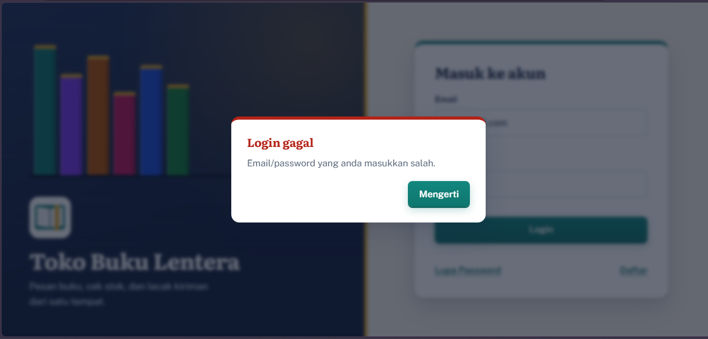

**Keterangan:**

`galat()` mengembalikan `true` jika tidak ada pesan error, sehingga hasilnya dapat dikumpulkan dalam array lalu diperiksa dengan `r.includes(false)`. Ini membuat seluruh kolom diperiksa sekaligus, bukan berhenti pada kesalahan pertama.

---

### 4. Halaman Login

**Tujuan:** Memeriksa email dan password sebelum pengguna masuk ke aplikasi.

**Pembahasan:** Form login memvalidasi email (wajib dan berformat benar) dan password (wajib). Jika benar, program mencari akun yang cocok pada daftar pengguna. Jika ditemukan, data pengguna disimpan di `sessionStorage` dan pengguna diarahkan ke dashboard. Jika tidak, pop-up error tampil.

**CODING HTML (`index.html`):**

```html
<main class="form-login">
  <h2>Masuk ke akun</h2>
  <form id="formLogin" novalidate>
    <label for="email">Email</label>
    <input type="email" id="email" autocomplete="username" placeholder="nama@gmail.com">
    <span class="galat" id="galatEmail"></span>
    <label for="password">Kata sandi</label>
    <input type="password" id="password" autocomplete="current-password" placeholder="">
    <span class="galat" id="galatPassword"></span>
    <button class="btn" type="submit" style="width:100%;margin-top:.8rem">Login</button>
  </form>
  <div class="aksi-bawah">
    <button class="tautan" id="btnLupa" type="button">Lupa Password</button>
    <button class="tautan" id="btnDaftar" type="button">Daftar</button>
  </div>
</main>
```

**CODING JavaScript:**

```javascript
function initLogin() {
  $("#formLogin").addEventListener("submit", (e) => {
    e.preventDefault();
    const email = $("#email"), pass = $("#password");
    const okE = galat(email, !email.value.trim() ? "Email wajib diisi." : !emailValid(email.value.trim()) ? "Format email tidak valid." : "");
    const okP = galat(pass, !pass.value ? "Password wajib diisi." : "");
    if (!okE || !okP) return;
    const akun = getPengguna().find((u) => u.email === email.value.trim().toLowerCase() && u.password === pass.value);
    if (!akun) return notify("Login gagal", "Email/password yang anda masukkan salah.", "error");
    sessionStorage.setItem("user", JSON.stringify({ nama: akun.nama, email: akun.email, role: akun.role }));
    location.href = "dashboard.html";
  });

  $("#btnLupa").addEventListener("click", () => buka("modalLupa"));
  $("#btnDaftar").addEventListener("click", () => buka("modalDaftar"));
  // ... (handler formLupa dan formDaftar ada di langkah 5)
}
```

**Hasil Browser:**

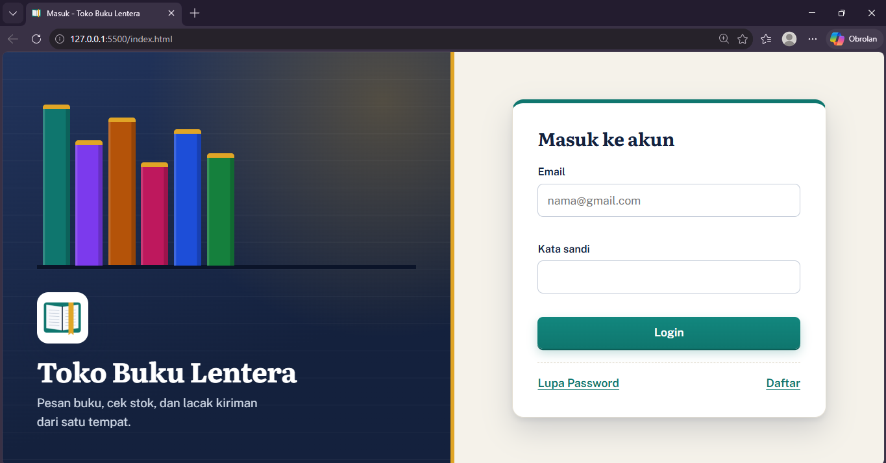

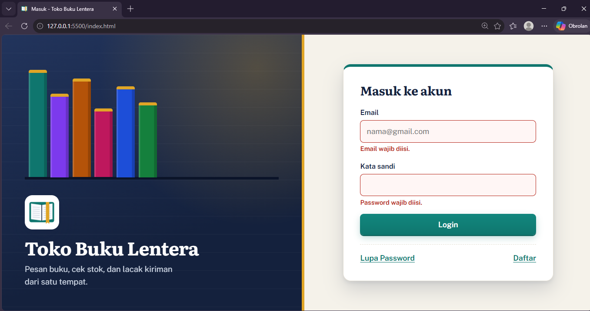

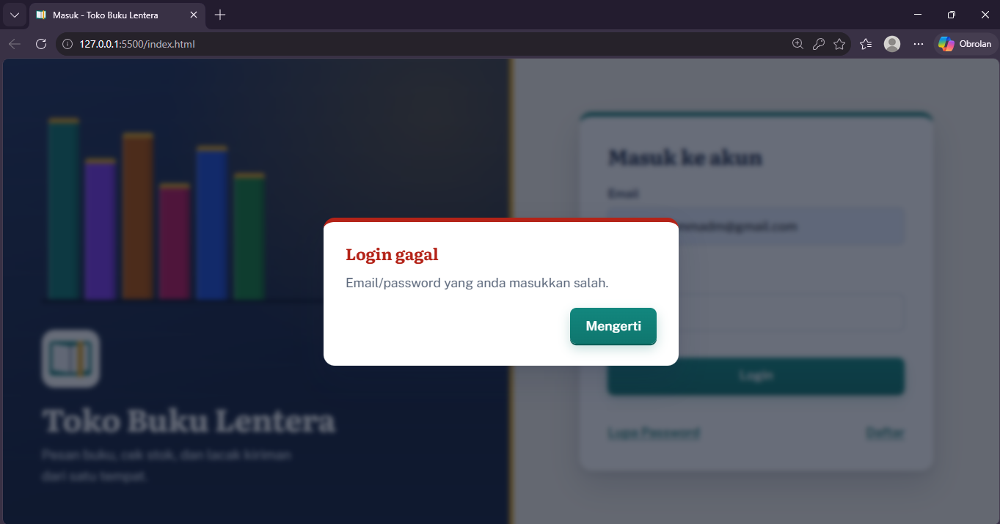

**Keterangan:**

Atribut `novalidate` mematikan validasi bawaan browser agar validasi JavaScript yang dipakai. `find()` mencari akun yang email dan passwordnya cocok. `sessionStorage` dipakai karena sesi login hanya berlaku selama tab browser terbuka.

---

### 5. Lupa Password dan Daftar Akun

**Tujuan:** Menyediakan pop-up untuk reset password dan pendaftaran akun baru.

**Pembahasan:** Kedua form berada di dalam elemen `.modal` pada `index.html` dan dibuka dengan menambahkan kelas `terbuka`. Pada pendaftaran, nama minimal 3 karakter, email harus valid dan belum terdaftar, dan password minimal 6 karakter. Akun baru disimpan ke `localStorage`.

**CODING HTML:**

```html
<div class="modal" id="modalLupa" role="dialog" aria-modal="true" aria-labelledby="jLupa">
  <form class="modal-box" id="formLupa" novalidate>
    <h2 id="jLupa">Lupa password</h2>
    <p>Masukkan email terdaftar. Kami kirim tautan untuk mengatur ulang kata sandi.</p>
    <label for="emailLupa">Email</label>
    <input type="email" id="emailLupa">
    <span class="galat" id="galatLupa"></span>
    <div class="aksi"><button type="button" class="btn sekunder" data-tutup>Batal</button><button class="btn" type="submit">Kirim tautan</button></div>
  </form>
</div>

<div class="modal" id="modalDaftar" role="dialog" aria-modal="true" aria-labelledby="jDaftar">
  <form class="modal-box" id="formDaftar" novalidate>
    <h2 id="jDaftar">Buat akun baru</h2>
    <label for="dNama">Nama lengkap</label><input id="dNama"><span class="galat"></span>
    <label for="dEmail">Email</label><input type="email" id="dEmail"><span class="galat"></span>
    <label for="dPass">Kata sandi (min. 6 karakter)</label><input type="password" id="dPass"><span class="galat"></span>
    <div class="aksi"><button type="button" class="btn sekunder" data-tutup>Batal</button><button class="btn" type="submit">Daftar</button></div>
  </form>
</div>
```

**CODING JavaScript:**

```javascript
  $("#formLupa").addEventListener("submit", (e) => {
    e.preventDefault();
    const inp = $("#emailLupa"), v = inp.value.trim().toLowerCase();
    if (!galat(inp, !emailValid(v) ? "Masukkan email yang valid." : "")) return;
    tutupModal($("#modalLupa"));
    if (getPengguna().some((u) => u.email === v)) notify("Tautan terkirim", "Tautan reset password dikirim ke " + v + ".");
    else notify("Email tidak ditemukan", "Email itu belum terdaftar. Silakan daftar dulu.", "error");
    inp.value = "";
  });

  $("#formDaftar").addEventListener("submit", (e) => {
    e.preventDefault();
    const [nama, email, pass] = [$("#dNama"), $("#dEmail"), $("#dPass")];
    const ev = email.value.trim().toLowerCase();
    const r = [
      galat(nama, nama.value.trim().length < 3 ? "Nama minimal 3 karakter." : ""),
      galat(email, !emailValid(ev) ? "Format email tidak valid." : getPengguna().some((u) => u.email === ev) ? "Email sudah terdaftar." : ""),
      galat(pass, pass.value.length < 6 ? "Password minimal 6 karakter." : "")
    ];
    if (r.includes(false)) return;
    const baru = ambil("lentera_pengguna", []);
    baru.push({ id: dataPengguna.length + baru.length + 1, nama: nama.value.trim(), email: ev, password: pass.value, role: "User" });
    simpan("lentera_pengguna", baru);
    e.target.reset();
    tutupModal($("#modalDaftar"));
    notify("Pendaftaran berhasil", "Akun dibuat. Silakan login dengan email " + ev + ".");
  });
```

**Hasil Browser:**

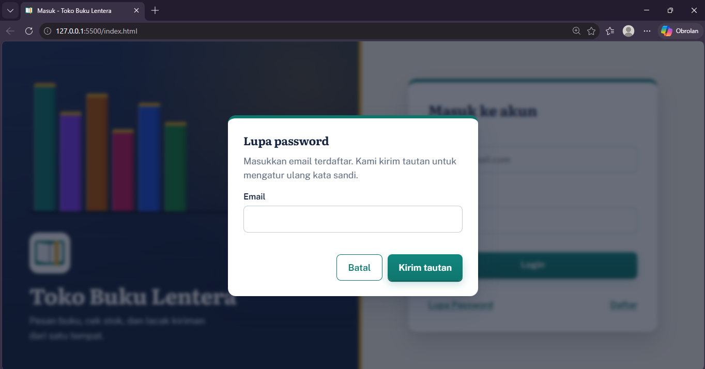

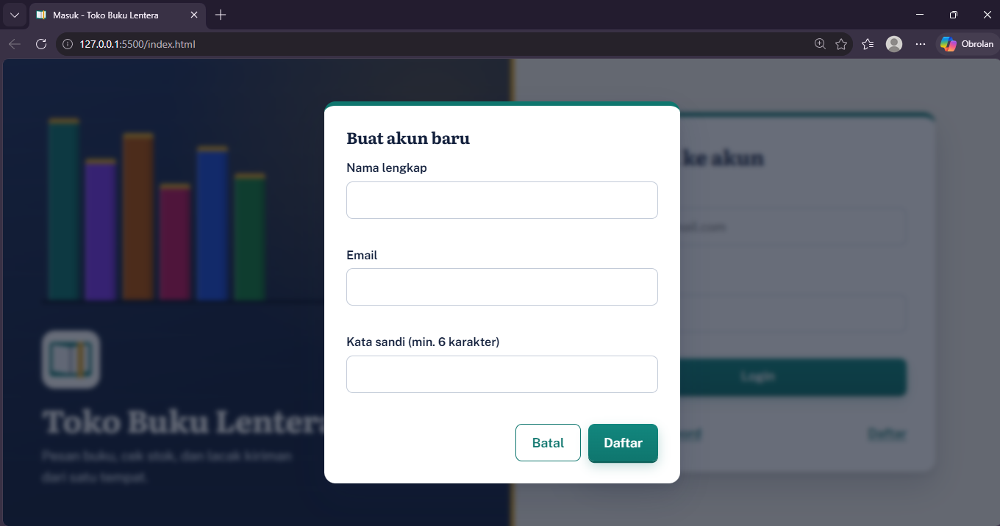

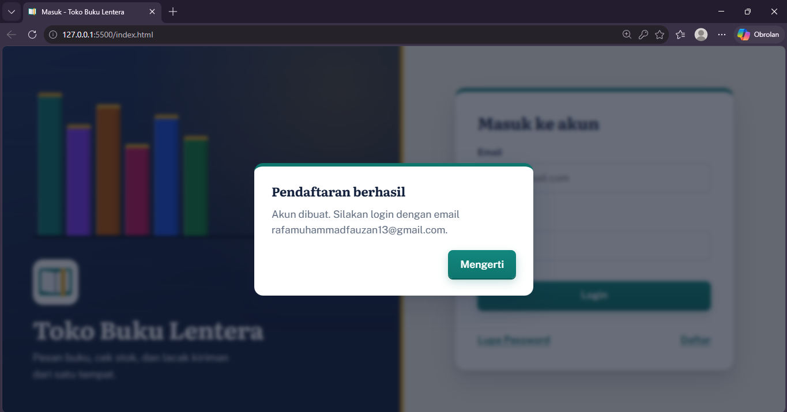

**Keterangan:**

`some()` dipakai untuk memeriksa apakah email sudah ada. Akun baru ditambahkan ke array lalu disimpan, sehingga bisa dipakai untuk login berikutnya.

---

### 6. Proteksi Halaman dan Logout

**Tujuan:** Mencegah halaman diakses tanpa login dan menyediakan tombol keluar.

**Pembahasan:** Pada setiap halaman selain login, program membaca `sessionStorage`. Jika data pengguna tidak ada, pengguna dialihkan ke `index.html`. Tombol "Keluar" menghapus data sesi.

**CODING:**

```javascript
const halaman = document.body.dataset.halaman;
const user = JSON.parse(sessionStorage.getItem("user") || "null");
if (halaman !== "login" && !user) location.replace("index.html");
const btnLogout = $("#btnLogout");
if (btnLogout) btnLogout.addEventListener("click", () => {
  sessionStorage.removeItem("user");
  location.href = "index.html";
});
```

Pemanggilan fungsi sesuai halaman di akhir `script.js`:

```javascript
if (halaman === "login" || user) ({ login: initLogin, dashboard: initDashboard, stok: initStok, checkout: initCheckout, tracking: initTracking, riwayat: initRiwayat })[halaman]();
```

**Hasil Browser:**

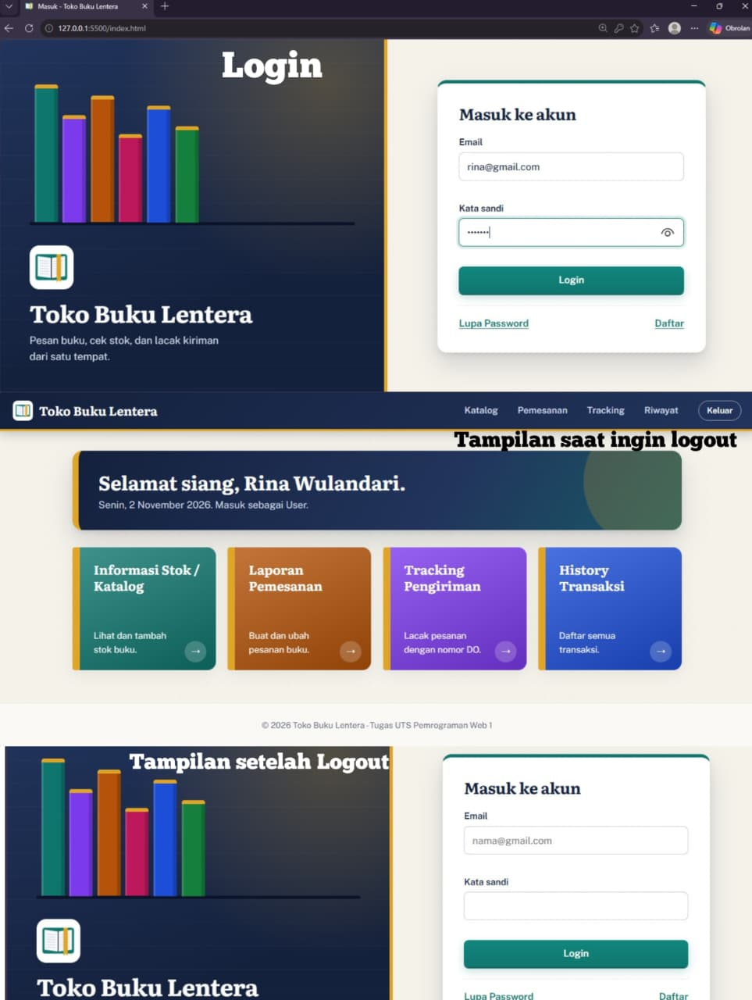

**Keterangan:**

`location.replace()` mengganti halaman tanpa menyimpan riwayat sehingga tombol Back tidak membawa pengguna kembali ke halaman yang terlindungi. Objek pemetaan di baris terakhir memilih fungsi `init...` yang sesuai nilai `data-halaman`.

---

### 7. Dashboard

**Tujuan:** Menampilkan salam, tanggal, peran pengguna, dan menu utama.

**Pembahasan:** Salam ("pagi", "siang", "sore", "malam") ditentukan dari jam saat ini dengan percabangan. Tanggal diformat dengan `toLocaleDateString("id-ID")`.

**CODING HTML (`dashboard.html`):**

```html
<main>
  <section aria-labelledby="salam">
    <h1 class="salam" id="salam">Halo</h1>
    <p id="tanggal"></p>
  </section>
  <section aria-label="Menu utama">
    <div class="menu">
      <a href="stok.html" style="background:#0f766e"><strong>Informasi Stok / Katalog</strong><span>Lihat dan tambah stok buku.</span></a>
      <a href="tracking.html" style="background:#7c3aed"><strong>Tracking Pengiriman</strong><span>Lacak pesanan dengan nomor DO.</span></a>
      <a href="checkout.html" style="background:#b45309"><strong>Laporan Pemesanan</strong><span>Buat dan ubah pesanan buku.</span></a>
      <a href="riwayat.html" style="background:#1d4ed8"><strong>History Transaksi</strong><span>Daftar semua transaksi.</span></a>
    </div>
  </section>
</main>
```

**CODING JavaScript:**

```javascript
function initDashboard() {
  const jam = new Date().getHours();
  const waktu = jam < 11 ? "pagi" : jam < 15 ? "siang" : jam < 18 ? "sore" : "malam";
  $("#salam").textContent = "Selamat " + waktu + ", " + user.nama + ".";
  $("#tanggal").textContent = new Date().toLocaleDateString("id-ID", { weekday: "long", day: "numeric", month: "long", year: "numeric" }) + ". Masuk sebagai " + user.role + ".";
}
```

**Hasil Browser:**

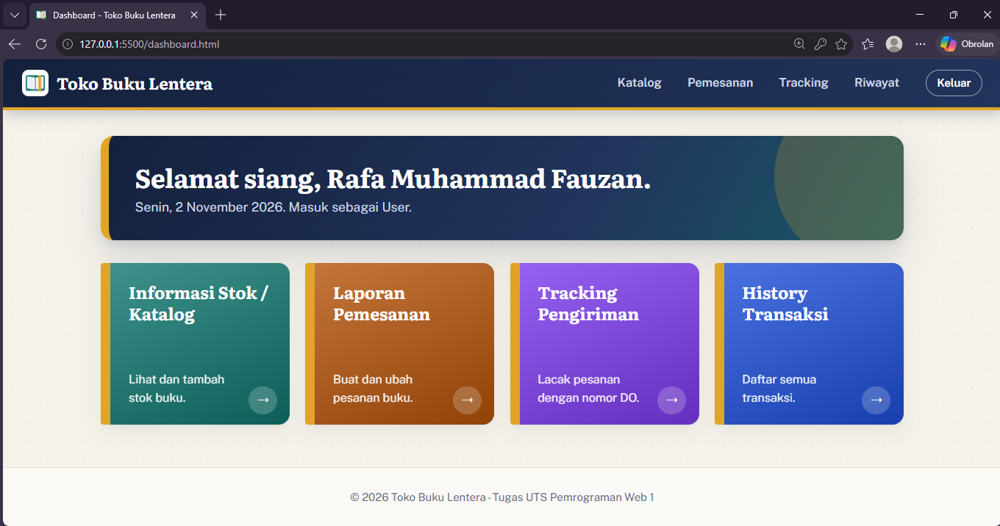

**Keterangan:**

Operator ternary bersarang dipakai untuk memilih kata waktu. Nama dan peran diambil dari objek `user` hasil login.

---

### 8. Informasi Stok / Katalog

**Tujuan:** Menampilkan daftar buku dalam tabel dengan pencarian dan indikator stok.

**Pembahasan:** Data katalog ditampilkan dengan perulangan `forEach()`. Setiap baris dibuat melalui DOM. Stok diberi lencana warna: normal (hijau), rendah (stok di bawah 100, oranye), dan habis (stok 0, merah). Kolom pencarian memfilter berdasarkan kode, nama, atau jenis barang. Jika gambar cover tidak ditemukan, program menampilkan huruf pertama judul sebagai pengganti.

**CODING HTML (`stok.html`):**

```html
<section class="card" aria-labelledby="hDaftar">
  <h2 id="hDaftar">Daftar katalog</h2>
  <label for="cari">Cari kode, nama, atau jenis</label>
  <input type="search" id="cari">
  <div class="tabel-bungkus"><table>
    <thead><tr><th>Cover</th><th>Kode</th><th>Nama barang</th><th>Jenis</th><th>Edisi</th><th class="angka">Harga</th><th>Stok</th><th>Aksi</th></tr></thead>
    <tbody id="tbStok"></tbody>
  </table></div>
</section>
```

**CODING JavaScript:**

```javascript
function cover(b) {
  const img = el("img", undefined, "sampul");
  img.src = b.cover; img.alt = "Cover " + b.namaBarang;
  img.onerror = () => img.replaceWith(el("span", b.namaBarang.charAt(0), "sampul"));
  return img;
}
function barisStok(b) {
  const tr = el("tr");
  const c0 = el("td"); c0.append(cover(b));
  const kelas = b.stok === 0 ? " habis" : b.stok < 100 ? " rendah" : "";
  const cs = el("td"); cs.append(el("span", String(b.stok), "lencana" + kelas));
  const hapus = el("button", "Hapus", "btn kecil bahaya");
  hapus.addEventListener("click", () => {
    if (!confirm("Hapus " + b.namaBarang + " dari katalog?")) return;
    simpan("lentera_katalog", getKatalog().filter((x) => x.kodeBarang !== b.kodeBarang));
    tr.remove();
  });
  const ca = el("td"); ca.append(hapus);
  tr.append(c0, el("td", b.kodeBarang), el("td", b.namaBarang), el("td", b.jenisBarang), el("td", b.edisi), el("td", b.harga, "angka"), cs, ca);
  return tr;
}
function initStok() {
  const tb = $("#tbStok");
  const tampil = () => {
    const q = $("#cari").value.trim().toLowerCase();
    tb.replaceChildren();
    const data = getKatalog().filter((b) => (b.kodeBarang + b.namaBarang + b.jenisBarang).toLowerCase().includes(q));
    if (!data.length) { const td = el("td", "Tidak ada buku yang cocok.", "kosong"); td.colSpan = 8; const tr = el("tr"); tr.append(td); tb.append(tr); return; }
    data.forEach((b) => tb.append(barisStok(b)));
  };
  tampil();
  $("#cari").addEventListener("input", tampil);
  // ... (form tambah stok ada di langkah 9)
}
```

**Hasil Browser:**

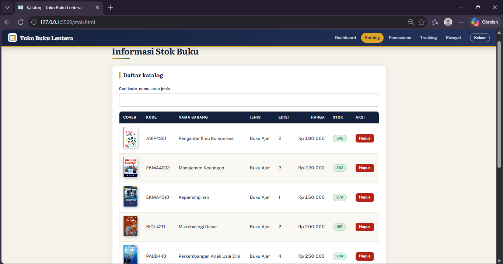

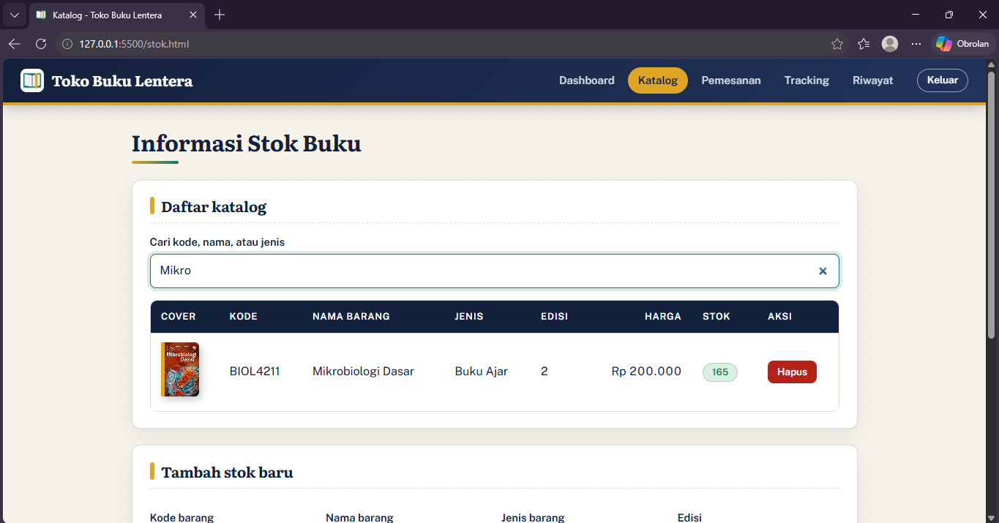

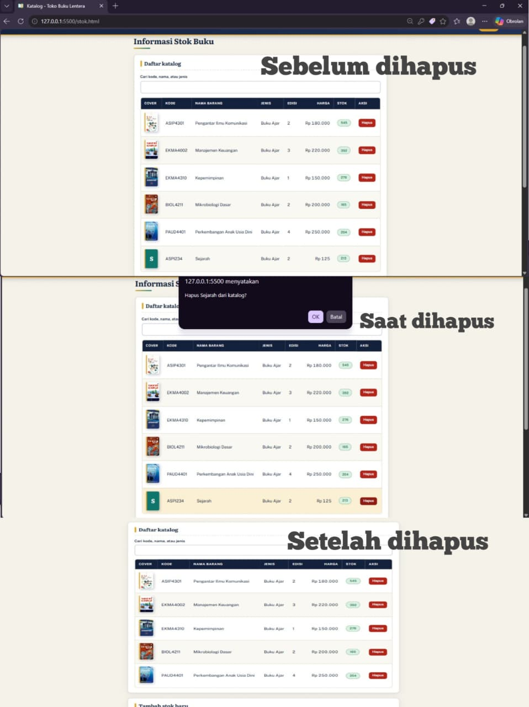

**Keterangan:**

`filter()` menyaring data sesuai kata pencarian, `replaceChildren()` mengosongkan isi tabel sebelum digambar ulang, dan event `input` membuat hasil pencarian langsung berubah saat mengetik. Tombol Hapus meminta konfirmasi dengan `confirm()` lalu menghapus data dari `localStorage` dan baris dari tabel.

---

### 9. Tambah Stok Baru

**Tujuan:** Menambahkan buku baru ke katalog dengan validasi lengkap.

**Pembahasan:** Form memiliki enam input: kode, nama, jenis, edisi, harga, dan stok. Kode barang diubah ke huruf besar dan harus unik. Harga diformat dengan `rupiah()`. Buku baru ditambahkan ke tabel lewat DOM tanpa memuat ulang halaman.

**CODING HTML:**

```html
<form id="formStok" novalidate>
  <div class="baris">
    <div><label for="kodeBarang">Kode barang</label><input id="kodeBarang" placeholder="ASIP4302"><span class="galat"></span></div>
    <div><label for="namaBarang">Nama barang</label><input id="namaBarang"><span class="galat"></span></div>
    <div><label for="jenisBarang">Jenis barang</label><input id="jenisBarang" value="Buku Ajar"><span class="galat"></span></div>
    <div><label for="edisi">Edisi</label><input type="number" id="edisi" min="1" value="1"><span class="galat"></span></div>
    <div><label for="harga">Harga (Rp)</label><input type="number" id="harga" min="1"><span class="galat"></span></div>
    <div><label for="stok">Stok</label><input type="number" id="stok" min="0"><span class="galat"></span></div>
  </div>
  <button class="btn" type="submit" style="margin-top:1rem">Tambah ke katalog</button>
</form>
```

**CODING JavaScript:**

```javascript
  $("#formStok").addEventListener("submit", (e) => {
    e.preventDefault();
    const f = Object.fromEntries(["kodeBarang", "namaBarang", "jenisBarang", "edisi", "harga", "stok"].map((i) => [i, $("#" + i)]));
    const katalog = getKatalog();
    const kode = f.kodeBarang.value.trim().toUpperCase();
    const r = [
      galat(f.kodeBarang, !kode ? "Kode wajib diisi." : katalog.some((b) => b.kodeBarang === kode) ? "Kode sudah dipakai." : ""),
      galat(f.namaBarang, !f.namaBarang.value.trim() ? "Nama barang wajib diisi." : ""),
      galat(f.jenisBarang, !f.jenisBarang.value.trim() ? "Jenis barang wajib diisi." : ""),
      galat(f.edisi, !(Number(f.edisi.value) >= 1) ? "Edisi minimal 1." : ""),
      galat(f.harga, !(Number(f.harga.value) > 0) ? "Harga harus lebih dari 0." : ""),
      galat(f.stok, f.stok.value === "" || Number(f.stok.value) < 0 ? "Stok minimal 0." : "")
    ];
    if (r.includes(false)) return notify("Data belum lengkap", "Periksa kolom yang ditandai merah.", "error");
    const baru = { kodeBarang: kode, namaBarang: f.namaBarang.value.trim(), jenisBarang: f.jenisBarang.value.trim(), edisi: String(Number(f.edisi.value)), stok: Number(f.stok.value), harga: rupiah(f.harga.value), cover: "img/" + kode.toLowerCase() + ".jpg" };
    katalog.push(baru);
    simpan("lentera_katalog", katalog);
    if (tb.querySelector(".kosong") || $("#cari").value) tampil(); else tb.append(barisStok(baru)); // tambah baris via DOM
    e.target.reset(); $("#jenisBarang").value = "Buku Ajar"; $("#edisi").value = 1;
    notify("Stok ditambahkan", baru.namaBarang + " masuk ke katalog.");
  });
```

**Hasil Browser:**

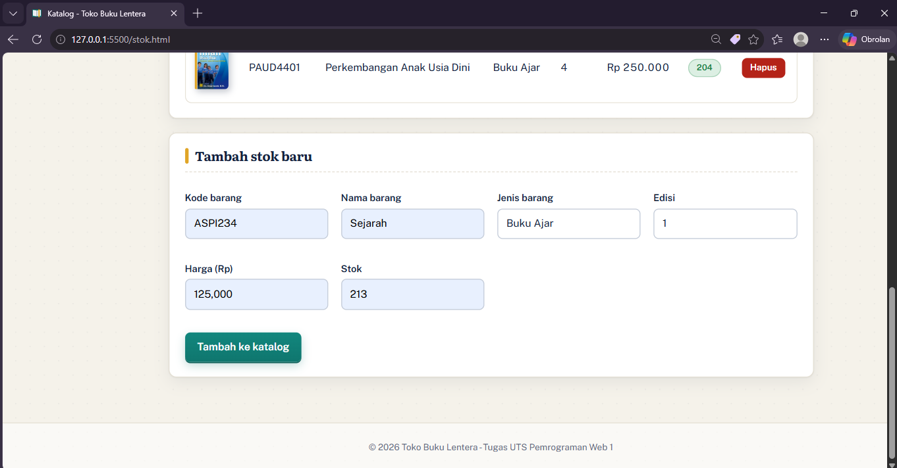

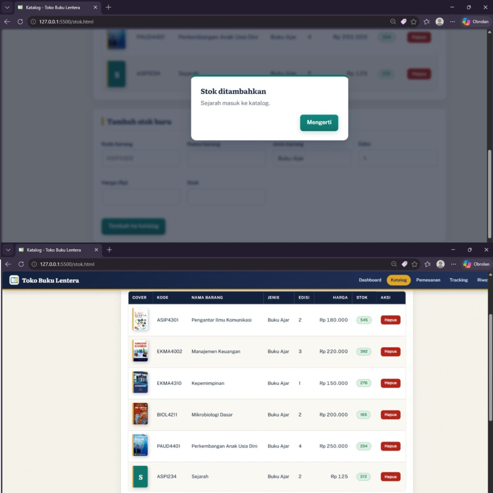

**Keterangan:**

`Object.fromEntries()` mengumpulkan semua input dalam satu objek `f` agar kode lebih ringkas. Jika validasi gagal, pop-up error tampil dan kolom yang salah diberi warna merah.

---

### 10. Pemesanan: Keranjang dan Perhitungan Total

**Tujuan:** Memilih buku dan jumlah, mengelola keranjang, dan menghitung subtotal, ongkir, serta total.

**Pembahasan:** Daftar buku pada `select` diisi dari katalog. Buku yang stoknya habis tidak dapat dipilih. Saat tombol "Tambah ke pesanan" ditekan, program memeriksa jumlah dan stok, lalu menyimpan item ke keranjang. Jumlah item dapat diubah langsung di tabel. Ongkir diambil dari atribut `data-ongkir` pada pilihan ekspedisi.

**CODING HTML (`checkout.html`):**

```html
<div class="baris">
  <div><label for="pilihBuku">Buku</label><select id="pilihBuku"></select></div>
  <div><label for="jumlah">Jumlah</label><input type="number" id="jumlah" min="1" value="1"></div>
  <div style="align-self:end"><button class="btn" id="btnTambah" type="button">Tambah ke pesanan</button></div>
</div>
<div class="tabel-bungkus"><table>
  <thead><tr><th>Judul</th><th class="angka">Harga</th><th>Jumlah</th><th class="angka">Subtotal</th><th>Aksi</th></tr></thead>
  <tbody id="tbKeranjang"></tbody>
</table></div>
```

**CODING JavaScript:**

```javascript
function initCheckout() {
  const getKeranjang = () => ambil("lentera_keranjang", []);
  const tb = $("#tbKeranjang"), pilih = $("#pilihBuku");
  $("#nama").value = user.nama;

  const isiPilihan = () => {
    pilih.replaceChildren();
    getKatalog().forEach((b) => {
      const o = el("option", b.namaBarang + " - " + b.harga + (b.stok === 0 ? " (habis)" : ""));
      o.value = b.kodeBarang; o.disabled = b.stok === 0;
      pilih.append(o);
    });
  };
  isiPilihan();

  const ongkir = () => Number($("#ekspedisi").selectedOptions[0].dataset.ongkir || 0);
  function tampil() {
    const kr = getKeranjang(), kat = getKatalog();
    tb.replaceChildren();
    let sub = 0;
    if (!kr.length) { const tr = el("tr"), td = el("td", "Belum ada buku di pesanan. Pilih buku lalu klik Tambah.", "kosong"); td.colSpan = 5; tr.append(td); tb.append(tr); }
    kr.forEach((item) => {
      const b = kat.find((x) => x.kodeBarang === item.kode);
      if (!b) return;
      const harga = angka(b.harga);
      sub += harga * item.jumlah;
      const tr = el("tr");
      const qty = el("input"); qty.type = "number"; qty.min = 1; qty.max = b.stok; qty.value = item.jumlah;
      qty.setAttribute("aria-label", "Jumlah " + b.namaBarang);
      qty.addEventListener("change", () => {
        const n = Math.floor(Number(qty.value));
        if (!(n >= 1) || n > b.stok) { notify("Jumlah tidak valid", "Jumlah harus 1 sampai " + b.stok + " (stok tersedia).", "error"); qty.value = item.jumlah; return; }
        item.jumlah = n; simpan("lentera_keranjang", kr); tampil();
      });
      const hapus = el("button", "Hapus", "btn kecil bahaya");
      hapus.addEventListener("click", () => { simpan("lentera_keranjang", kr.filter((x) => x !== item)); tampil(); });
      const cq = el("td"); cq.append(qty);
      const ca = el("td"); ca.append(hapus);
      tr.append(el("td", b.namaBarang), el("td", b.harga, "angka"), cq, el("td", rupiah(harga * item.jumlah), "angka"), ca);
      tb.append(tr);
    });
    $("#subtotal").textContent = rupiah(sub);
    $("#ongkir").textContent = rupiah(sub ? ongkir() : 0);
    $("#total").textContent = rupiah(sub ? sub + ongkir() : 0);
  }
  tampil();
  $("#ekspedisi").addEventListener("change", tampil);

  $("#btnTambah").addEventListener("click", () => {
    const b = getKatalog().find((x) => x.kodeBarang === pilih.value);
    const n = Math.floor(Number($("#jumlah").value));
    if (!b) return notify("Pilih buku", "Pilih satu buku dulu.", "error");
    if (!(n >= 1)) return notify("Jumlah tidak valid", "Jumlah minimal 1.", "error");
    const kr = getKeranjang();
    const ada = kr.find((x) => x.kode === b.kodeBarang);
    const total = (ada ? ada.jumlah : 0) + n;
    if (total > b.stok) return notify("Stok tidak cukup", "Stok " + b.namaBarang + " tinggal " + b.stok + ".", "error");
    if (ada) ada.jumlah = total; else kr.push({ kode: b.kodeBarang, jumlah: n });
    simpan("lentera_keranjang", kr); tampil();
  });
```

**Hasil Browser:**

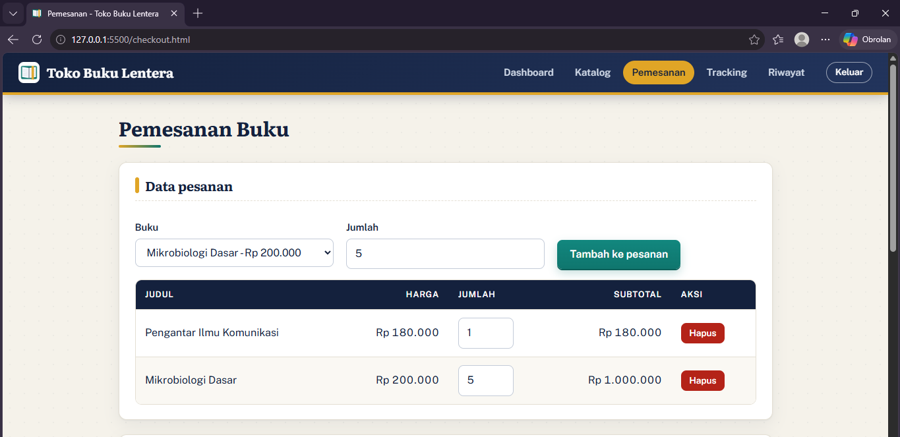

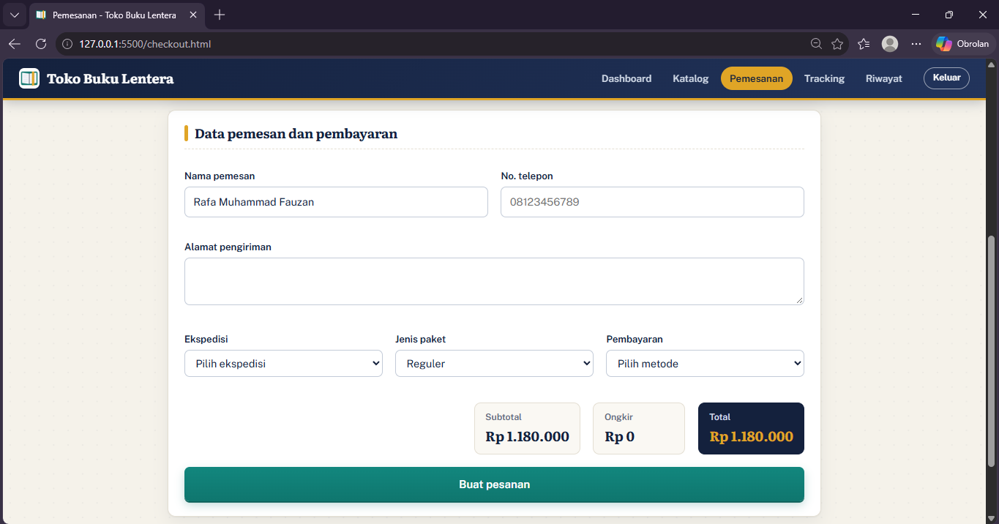

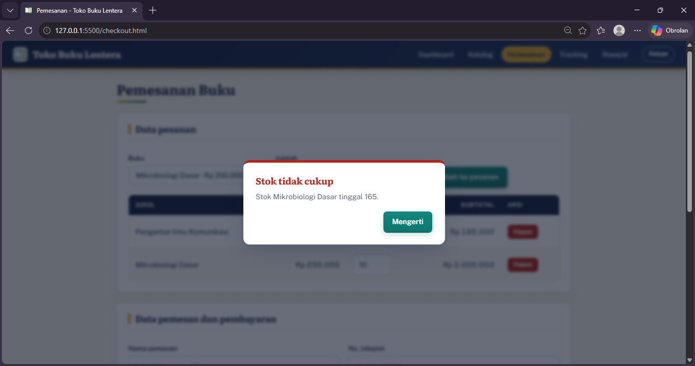

**Keterangan:**

Setiap kali keranjang berubah, fungsi `tampil()` menggambar ulang tabel dan menghitung ulang subtotal, ongkir, dan total. Jika buku yang sama ditambahkan lagi, jumlahnya digabung, dan total jumlah tidak boleh melebihi stok.

---

### 11. Pemesanan: Data Pemesan dan Buat Pesanan

**Tujuan:** Memvalidasi data pemesan lalu membuat pesanan dengan nomor DO baru.

**Pembahasan:** Nomor telepon harus diawali `08` dan terdiri dari 10–13 digit. Alamat minimal 10 karakter. Ekspedisi dan metode pembayaran wajib dipilih. Setelah valid, stok dikurangi, nomor DO acak dibuat (dipastikan belum dipakai), data tracking baru disimpan, dan keranjang dikosongkan.

**CODING HTML:**

```html
<form id="formPesan" novalidate>
  <div class="baris">
    <div><label for="nama">Nama pemesan</label><input id="nama"><span class="galat"></span></div>
    <div><label for="telepon">No. telepon</label><input id="telepon" placeholder="08123456789"><span class="galat"></span></div>
  </div>
  <label for="alamat">Alamat pengiriman</label><textarea id="alamat" rows="2"></textarea><span class="galat"></span>
  <div class="baris">
    <div><label for="ekspedisi">Ekspedisi</label><select id="ekspedisi"><option value="">Pilih ekspedisi</option><option value="JNE" data-ongkir="15000">JNE (Rp 15.000)</option><option value="J&amp;T Express" data-ongkir="14000">J&amp;T Express (Rp 14.000)</option><option value="Pos Indonesia" data-ongkir="12000">Pos Indonesia (Rp 12.000)</option></select><span class="galat"></span></div>
    <div><label for="paket">Jenis paket</label><select id="paket"><option value="Reguler">Reguler</option><option value="Ekspres">Ekspres</option></select></div>
    <div><label for="metode">Pembayaran</label><select id="metode"><option value="">Pilih metode</option><option>Transfer Bank</option><option>E-Wallet</option><option>COD</option></select><span class="galat"></span></div>
  </div>
  <div class="ringkas"><span>Subtotal <strong id="subtotal">Rp 0</strong></span><span>Ongkir <strong id="ongkir">Rp 0</strong></span><span>Total <strong id="total">Rp 0</strong></span></div>
  <button class="btn" type="submit">Buat pesanan</button>
</form>
```

**CODING JavaScript:**

```javascript
  $("#formPesan").addEventListener("submit", (e) => {
    e.preventDefault();
    const [nama, tel, alamat, eks, metode] = ["nama", "telepon", "alamat", "ekspedisi", "metode"].map((i) => $("#" + i));
    const r = [
      galat(nama, nama.value.trim().length < 3 ? "Nama minimal 3 karakter." : ""),
      galat(tel, !/^08\d{8,11}$/.test(tel.value.trim()) ? "Nomor harus diawali 08 dan 10-13 digit." : ""),
      galat(alamat, alamat.value.trim().length < 10 ? "Alamat minimal 10 karakter." : ""),
      galat(eks, !eks.value ? "Pilih ekspedisi." : ""),
      galat(metode, !metode.value ? "Pilih metode pembayaran." : "")
    ];
    if (r.includes(false)) return notify("Form belum benar", "Periksa kolom yang ditandai merah.", "error");
    const kr = getKeranjang();
    if (!kr.length) return notify("Pesanan kosong", "Tambahkan minimal satu buku.", "error");

    const kat = getKatalog();
    let sub = 0;
    const ringkas = [];
    for (const item of kr) {
      const b = kat.find((x) => x.kodeBarang === item.kode);
      if (!b || item.jumlah > b.stok) return notify("Stok berubah", "Stok salah satu buku tidak cukup. Ubah jumlahnya.", "error");
      sub += angka(b.harga) * item.jumlah;
      ringkas.push(b.namaBarang + " x" + item.jumlah);
    }
    kr.forEach((item) => { kat.find((x) => x.kodeBarang === item.kode).stok -= item.jumlah; });
    simpan("lentera_katalog", kat);

    const semua = getTracking().map((t) => t.nomorDO);
    let noDO;
    do { noDO = "2026" + String(Math.floor(1000 + Math.random() * 9000)); } while (semua.includes(noDO));
    const sekarang = new Date();
    const tgl = sekarang.toISOString().slice(0, 10);
    const waktu = tgl + " " + sekarang.toTimeString().slice(0, 8);
    simpan("lentera_tracking", [{
      nomorDO: noDO, nama: nama.value.trim(), status: "Diproses", ekspedisi: eks.value, tanggalKirim: tgl,
      paket: $("#paket").value, total: rupiah(sub + ongkir()),
      perjalanan: [{ waktu, keterangan: "Pesanan diterima (" + ringkas.join(", ") + "). Pembayaran: " + metode.value }]
    }, ...ambil("lentera_tracking", [])]);
    simpan("lentera_keranjang", []);
    e.target.reset(); $("#nama").value = user.nama;
    isiPilihan(); tampil();
    notify("Pesanan berhasil", "Nomor Delivery Order: " + noDO + ". Simpan nomor ini untuk melacak pengiriman.");
  });
}
```

**Hasil Browser:**

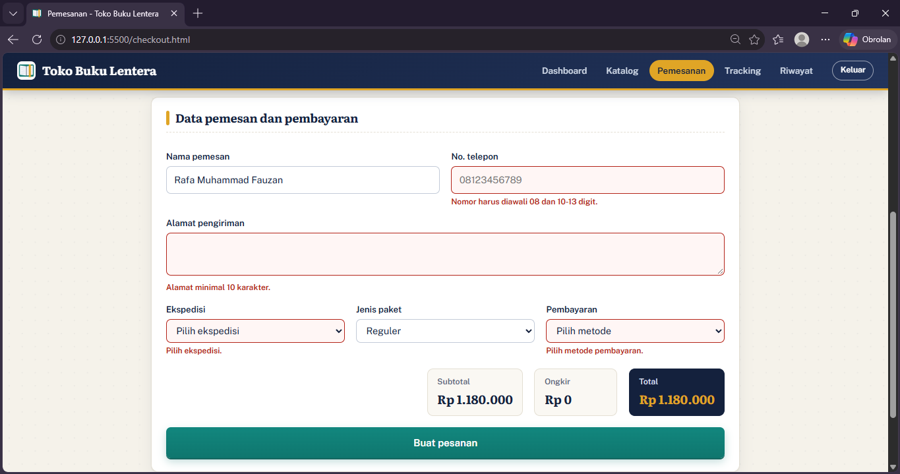

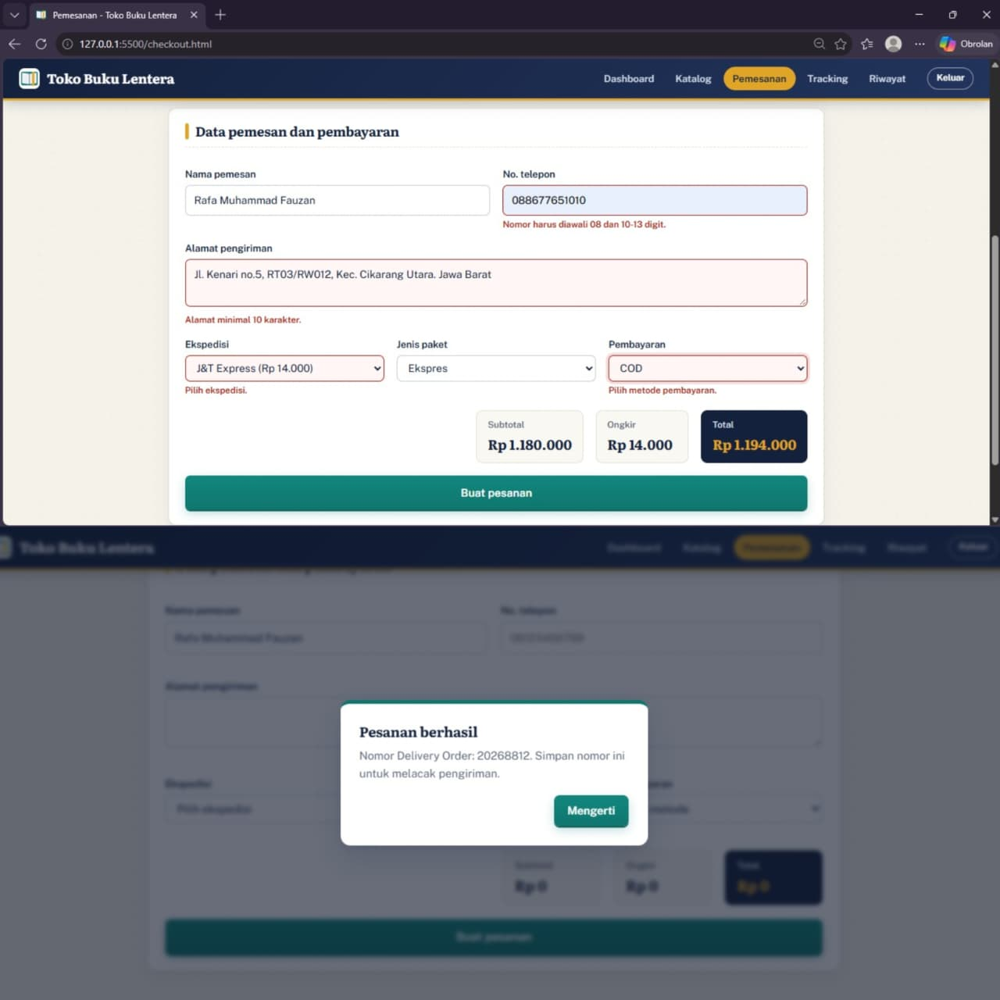

**Keterangan:**

Ekspresi reguler `/^08\d{8,11}$/` memastikan nomor telepon diawali 08 diikuti 8–11 angka. Perulangan `do...while` mengulang pembuatan nomor DO sampai nomornya belum dipakai. Operator spread (`...`) menaruh pesanan terbaru di urutan paling depan.

---

### 12. Tracking Pengiriman

**Tujuan:** Menampilkan status dan perjalanan paket berdasarkan nomor DO.

**Pembahasan:** Nomor DO divalidasi (wajib dan hanya angka). Jika ditemukan, program mengisi data pesanan ke elemen berlabel `data-f`, mengatur lebar bar progres, menampilkan tahap pengiriman, dan membuat daftar perjalanan paket. Jika tidak ditemukan, pop-up error tampil. Parameter `?do=` pada URL membuat riwayat dapat langsung membuka tracking.

**CODING HTML (`tracking.html`):**

```html
<form id="formTrack" novalidate>
  <label for="noDO">Nomor Delivery Order</label>
  <div style="display:flex;gap:.6rem"><input id="noDO" placeholder="20230012" inputmode="numeric"><button class="btn" type="submit">Cari</button></div>
  <span class="galat" id="galatDO"></span>
</form>

<section class="card" id="hasil" hidden aria-live="polite">
  <h2>Pesanan <span data-f="nomorDO"></span></h2>
  <div class="bar" role="progressbar" aria-valuemin="0" aria-valuemax="100"><div id="isiBar"></div></div>
  <ol class="langkah" id="langkah"></ol>
  <p><span class="lencana" id="lencanaStatus"></span></p>
  <dl>
    <dt>Nama pemesan</dt><dd data-f="nama"></dd>
    <dt>Ekspedisi</dt><dd data-f="ekspedisi"></dd>
    <dt>Tanggal kirim</dt><dd data-f="tanggalKirim"></dd>
    <dt>Jenis paket</dt><dd data-f="paket"></dd>
    <dt>Total pembayaran</dt><dd data-f="total"></dd>
  </dl>
  <h3 style="margin-top:1.2rem">Perjalanan paket</h3>
  <ol class="garis-waktu" id="perjalanan"></ol>
</section>
```

**CODING JavaScript:**

```javascript
function persenStatus(d) {
  const akhir = d.perjalanan && d.perjalanan.length ? d.perjalanan[d.perjalanan.length - 1].keterangan : "";
  if (/^selesai/i.test(akhir) || /selesai|terkirim|diterima/i.test(d.status)) return 100;
  const peta = { "diproses": 15, "dikirim": 50, "dalam perjalanan": 75 };
  return peta[d.status.toLowerCase()] ?? 25;
}
const TAHAP = ["Diproses", "Dikemas", "Dalam pengiriman", "Diterima"];
function indeksTahap(d) {
  const akhir = d.perjalanan.length ? d.perjalanan[d.perjalanan.length - 1].keterangan : "";
  if (/^selesai/i.test(akhir) || /selesai|terkirim|diterima/i.test(d.status)) return 3;
  const s = d.status.toLowerCase();
  if (s === "dikemas") return 1;
  if (s === "dikirim" || s === "dalam perjalanan") return 2;
  return 0;
}
function initTracking() {
  const cari = (no) => {
    const inp = $("#noDO"), v = no.trim();
    if (!galat(inp, !v ? "Nomor DO wajib diisi." : !/^\d+$/.test(v) ? "Nomor DO hanya berisi angka." : "")) { $("#hasil").hidden = true; return; }
    const d = getTracking().find((x) => x.nomorDO === v);
    if (!d) { $("#hasil").hidden = true; return notify("Pesanan tidak ditemukan", "Tidak ada pesanan dengan nomor " + v + ". Coba 20230012.", "error"); }
    document.querySelectorAll("[data-f]").forEach((n) => { n.textContent = d[n.dataset.f]; });
    const p = persenStatus(d);
    $("#isiBar").style.width = p + "%";
    $("#isiBar").parentElement.setAttribute("aria-valuenow", p);
    const lb = $("#lencanaStatus"); lb.textContent = d.status; lb.className = "lencana" + (p < 100 ? " rendah" : "");
    const idx = indeksTahap(d);
    const langkah = $("#langkah"); langkah.replaceChildren();
    TAHAP.forEach((t, i) => langkah.append(el("li", t, i < idx || idx === 3 ? "selesai" : i === idx ? "aktif" : "")));
    const ol = $("#perjalanan"); ol.replaceChildren();
    d.perjalanan.forEach((s, i) => {
      const li = el("li", undefined, i === d.perjalanan.length - 1 ? "aktif" : "");
      li.append(el("strong", s.keterangan), el("small", s.waktu));
      ol.append(li);
    });
    $("#hasil").hidden = false;
  };
  $("#formTrack").addEventListener("submit", (e) => { e.preventDefault(); cari($("#noDO").value); });
  const q = new URLSearchParams(location.search).get("do");
  if (q) { $("#noDO").value = q; cari(q); }
}
```

**Hasil Browser:**

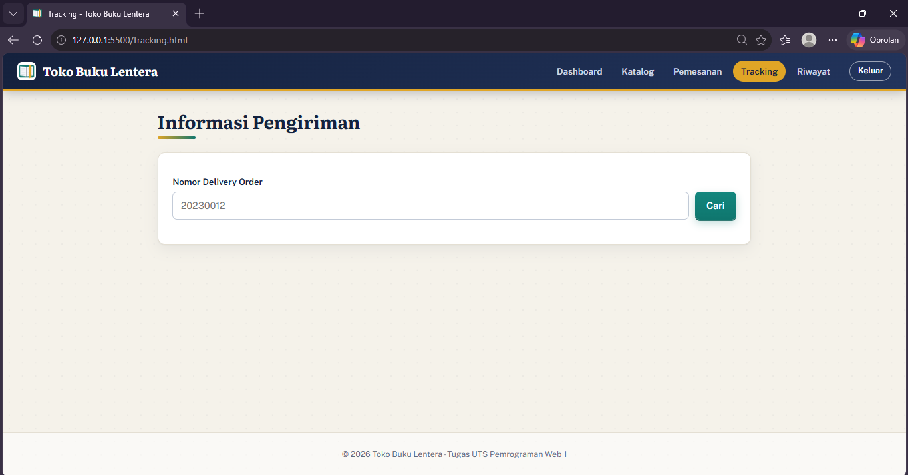

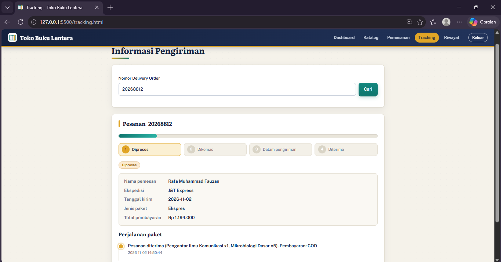

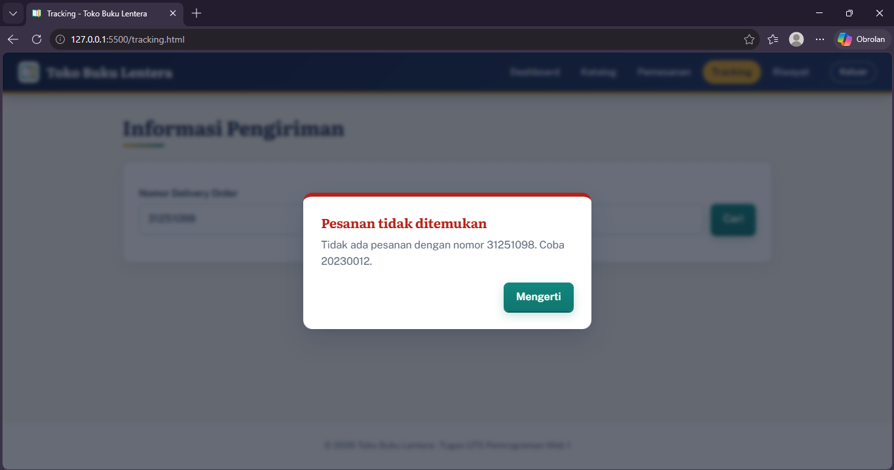

**Keterangan:**

Atribut `data-f` pada elemen HTML dicocokkan dengan nama properti objek pesanan sehingga semua data terisi dengan satu perulangan. Persentase progres dan tahap pengiriman ditentukan dari status serta keterangan perjalanan terakhir.

---

### 13. Riwayat Transaksi

**Tujuan:** Menampilkan semua transaksi beserta jumlah dan total nilainya.

**Pembahasan:** Data tracking diurutkan dari tanggal terbaru dengan `sort()`. Setiap nomor DO menjadi tautan ke halaman tracking. Jumlah transaksi dan total nilai dihitung dengan `reduce()`.

**CODING HTML (`riwayat.html`):**

```html
<section class="card"><div class="ringkas" style="justify-content:flex-start"><span>Jumlah transaksi <strong id="jmlTrx">0</strong></span><span>Total nilai <strong id="nilaiTrx">Rp 0</strong></span></div></section>
<section class="card"><div class="tabel-bungkus"><table>
  <thead><tr><th>No. DO</th><th>Tanggal kirim</th><th>Pemesan</th><th>Ekspedisi</th><th class="angka">Total</th><th>Status</th></tr></thead>
  <tbody id="tbRiwayat"></tbody>
</table></div></section>
```

**CODING JavaScript:**

```javascript
function initRiwayat() {
  const data = getTracking().sort((a, b) => b.tanggalKirim.localeCompare(a.tanggalKirim)), tb = $("#tbRiwayat");
  data.forEach((t) => {
    const tr = el("tr"), tdDO = el("td"), a = el("a", t.nomorDO);
    a.href = "tracking.html?do=" + encodeURIComponent(t.nomorDO);
    tdDO.append(a);
    tr.append(tdDO, el("td", t.tanggalKirim), el("td", t.nama), el("td", t.ekspedisi), el("td", t.total, "angka"), el("td", t.status));
    tb.append(tr);
  });
  $("#jmlTrx").textContent = data.length;
  $("#nilaiTrx").textContent = rupiah(data.reduce((s, t) => s + angka(t.total), 0));
}
```

**Hasil Browser:**

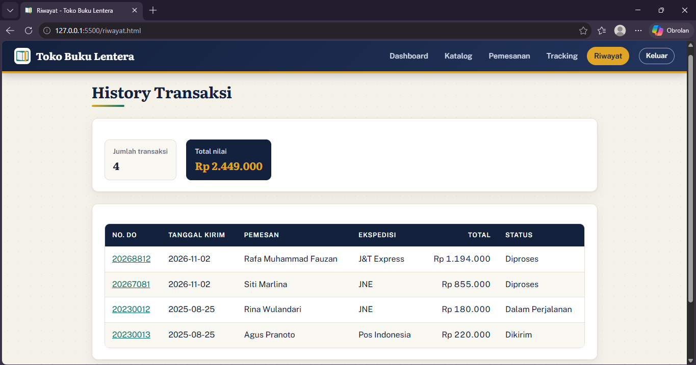

**Keterangan:**

`reduce()` menjumlahkan seluruh nilai transaksi setelah teks `"Rp 180.000"` diubah menjadi angka oleh `angka()`. Klik pada nomor DO membuka `tracking.html?do=...` dan hasilnya langsung tampil.

---

### 14. Tampilan (CSS)

**Tujuan:** Membuat tampilan yang konsisten, rapi, responsif, dan mudah dibaca.

**Pembahasan:** Warna dan font diatur melalui variabel CSS di `:root`. Layout memakai flexbox dan grid. Tabel, kartu, tombol, pop-up, bar progres, langkah pengiriman, dan garis waktu memiliki gaya tersendiri. Media query menyesuaikan tampilan untuk layar kecil, dan animasi dimatikan untuk pengguna yang memilih `prefers-reduced-motion`.

**CODING (cuplikan `css/style.css`):**

```css
:root{
  --ink:#14213d;
  --teal:#0f766e;
  --gold:#e0a526;
  --paper:#f5f2ea;
  --card:#fff;
  --line:#e4dfd3;
  --bad:#b42318;
  --ok:#15803d;
  --serif:"Literata",Georgia,serif;
  --sans:"Public Sans",system-ui,sans-serif;
}

.topbar{
  position:sticky;top:0;z-index:20;
  display:flex;flex-wrap:wrap;align-items:center;gap:.6rem 1.2rem;
  background:linear-gradient(135deg,var(--ink) 0%,#22345c 100%);
  color:#fff;padding:.75rem 1.5rem;border-bottom:4px solid var(--gold);
}

.card{
  background:var(--card);border:1px solid var(--line);border-radius:12px;
  padding:1.4rem 1.5rem;margin-bottom:1.4rem;
}

.modal{
  position:fixed;inset:0;background:rgba(12,20,38,.62);
  display:none;align-items:center;justify-content:center;padding:1rem;z-index:50;
}
.modal.terbuka{display:flex}

@media(max-width:700px){
  main{padding:1.2rem 1rem}
  .langkah{grid-template-columns:1fr 1fr}
}
@media(prefers-reduced-motion:reduce){
  *,*::before,*::after{transition:none!important;animation:none!important}
}
```

> Kode CSS lengkap ada pada file `css/style.css` di repository.


**Hasil Browser:**

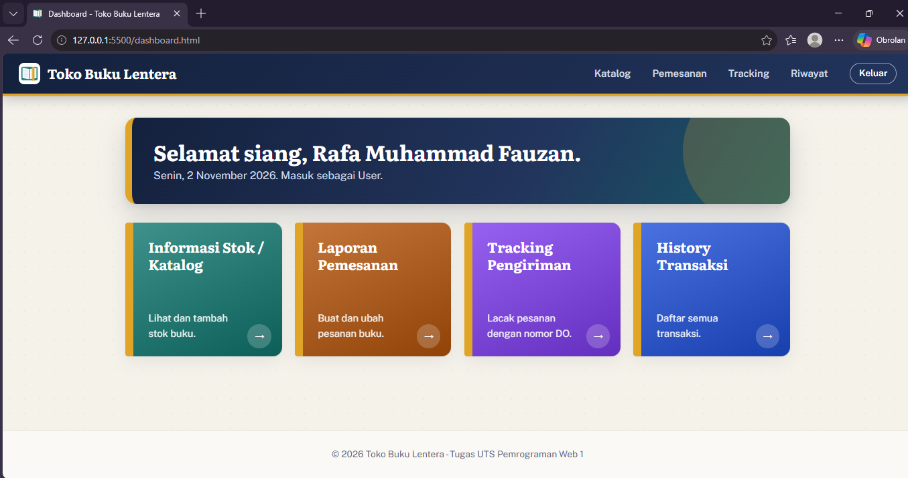

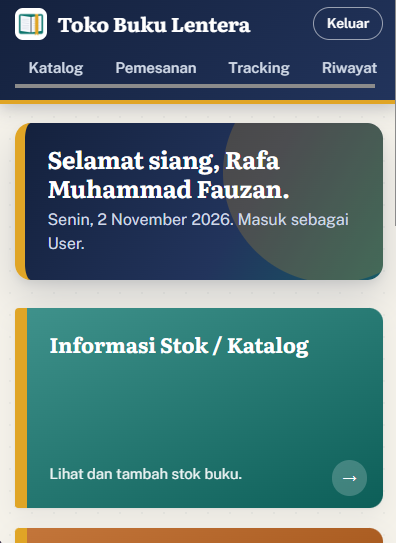

**Keterangan:**

Kelas seperti `.modal.terbuka` dan `.lencana.rendah` dipasang oleh JavaScript, sehingga perubahan tampilan dikendalikan lewat pergantian kelas CSS, bukan dengan mengubah gaya satu per satu.

---

## Video Penjelasan dan Demo

Video penjelasan project dan demo seluruh proses di atas:

**https://youtu.be/0JtJS40OuJw?si=D807603Y9XcUdE2O**

## Kesimpulan

Berdasarkan project Toko Buku Lentera, dapat disimpulkan bahwa HTML, CSS, dan JavaScript dapat membentuk aplikasi web yang lengkap tanpa server. Materi yang diterapkan meliputi variabel, array dan objek, function, percabangan, perulangan, manipulasi DOM, event, validasi form, ekspresi reguler, `localStorage`, dan `sessionStorage`.

Alur aplikasi berjalan dari login, proteksi halaman, katalog dan stok, pemesanan dengan perhitungan otomatis, tracking pengiriman berdasarkan nomor DO, hingga riwayat transaksi. Validasi pada setiap form dan pop-up pesan membuat penggunaan aplikasi lebih jelas dan aman dari kesalahan input.

## Dokumentasi

Screenshot codingan dan hasil browser diletakkan setelah penjelasan masing-masing langkah di folder `images/`. Pastikan nama file gambar sama dengan yang tertulis di README ini dan semua gambar sudah ada di repository. Pastikan juga repository dan video YouTube berstatus **Public** sebelum link dikumpulkan.
